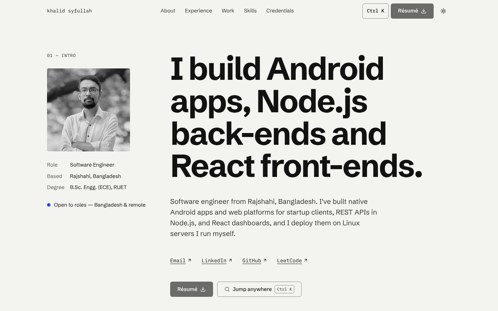
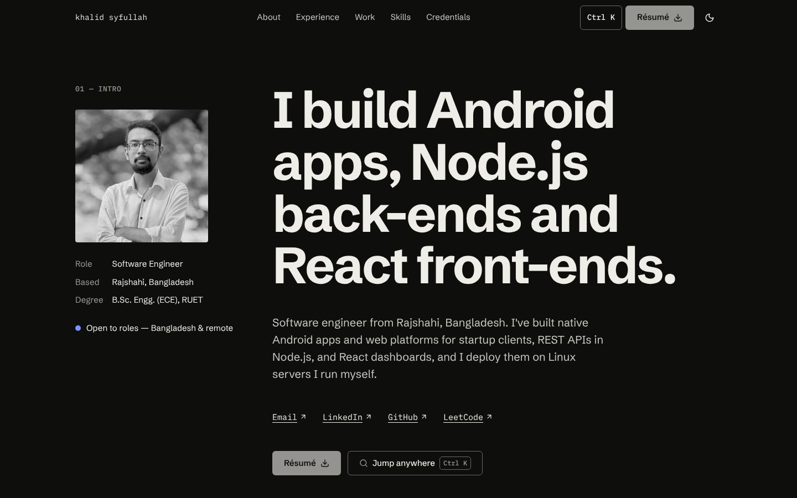
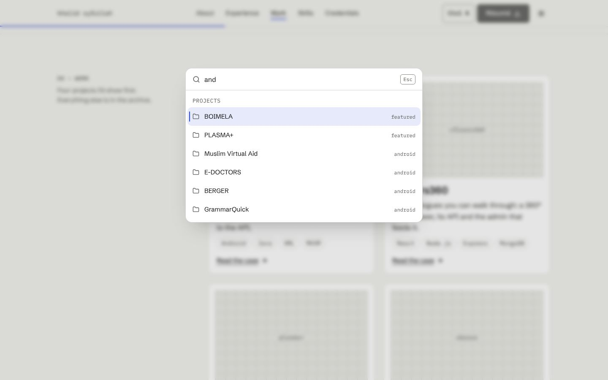
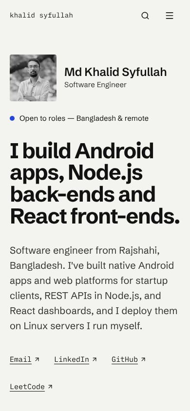

# Khalid Portfolio — khalidsyfullah.com

[](https://github.com/Khalid-Syfullah/khalid-portfolio/actions/workflows/ci.yml)

The personal site of **Md Khalid Syfullah, Software Engineer**. It's a single-page, résumé-style portfolio that you can operate from the keyboard: a ⌘K command menu, expandable experience rows, project case dialogs, filterable projects, light/dark themes, and a print stylesheet that turns the page into a two-page résumé.

> **Status:** Phase 7 — Deploy. The site is built and merged. Hosting is moving from AWS Lightsail to free Cloudflare hosting: the repo config is ready, and the DNS move and repo connection in [`docs/DEPLOY.md`](docs/DEPLOY.md) come next.



| Dark theme | Command menu | Phone |
|---|---|---|
|  |  |  |

## Progress

| Phase | What | State |
|---|---|---|
| 1 · Research | Reference galleries, the old site, the brief | ✅ Done |
| 2 · Plan | [`docs/PLAN.md`](docs/PLAN.md) | ✅ Done |
| 3 · Design | [`DESIGN.md`](DESIGN.md) + [`docs/design/`](docs/design/) | ✅ Approved 21 Oct |
| 4 · Review | Design sign-off | ✅ 21 Oct |
| 5 · Build | Next.js 16 + Tailwind v4 + shadcn/ui + Motion | ✅ Merged (PR #1) |
| 6 · Optimize | Lighthouse desktop 100/100/100/100; mobile a11y/BP/SEO 100 ([details](docs/design/09-quality.md)) | ✅ Merged |
| 7 · Deploy | Cloudflare Workers (free) + Workers Builds ([`docs/DEPLOY.md`](docs/DEPLOY.md)) | 🟡 Config ready; DNS move next |

**Still needed from Khalid** (shown on the site as dashed blue placeholders): the software-engineering résumé PDF, project screenshots, two project years, and the constraint/decision/outcome notes for some case studies. The list is in [`docs/design/08-content.md`](docs/design/08-content.md).

## Stack

Next.js 16 (App Router, TypeScript, static export) · React 19 · Tailwind CSS v4 · shadcn/ui (Radix) · cmdk · vaul · Motion · next-themes · lucide-react · sonner. Served as static files by Cloudflare (Workers static assets, Free plan).

## Local development

Requires Node.js 20.9+ (CI uses 22).

```bash
npm ci
npm run dev      # http://localhost:3000
npm run lint
npm run build    # static site in out/
```

Preview the production build with Cloudflare's runtime: `npx wrangler dev` (http://localhost:8787, uses `wrangler.jsonc` and `public/_headers`).

## Where things live

```
app/                 layout (fonts, metadata), page, globals.css (design tokens), 404, icons, OG image
components/          sections/ (hero, about, experience, work, skills, credentials), header,
                     command menu, case dialog, archive, footer; ui/ = shadcn primitives
content/             all copy and data (site, experience, projects, skills, credentials)
lib/                 ui-store (shared UI state + URL sync), hooks, motion tokens, navigation
public/              photos (AVIF/WebP/JPEG), robots.txt, sitemap.xml, _headers (Cloudflare)
.github/workflows/   ci.yml
wrangler.jsonc       Cloudflare Worker config (serves out/)
docs/                PLAN.md, DEPLOY.md, design/ (spec files), screenshots/
DESIGN.md            design entry point
```

**To change content**, edit `content/*.ts`. To change colours, type or spacing, edit `app/globals.css` and keep `docs/design/02-tokens.md` in step.

## Docs

| File | What's in it |
|---|---|
| [`docs/PLAN.md`](docs/PLAN.md) | Research, decisions, phases and gates |
| [`DESIGN.md`](DESIGN.md) | Design entry point: concept, principles, file index |
| [`docs/design/01-direction.md`](docs/design/01-direction.md) … [`09-quality.md`](docs/design/09-quality.md) | Direction, tokens, layout, sections, components, interactions, motion, content, quality |
| [`docs/DEPLOY.md`](docs/DEPLOY.md) | CI/CD, Cloudflare setup, DNS records to keep |

## CI/CD

- **CI** (`.github/workflows/ci.yml`): every pull request and every push, `main` included, runs install → lint → test → build (static export to `out/`) → `wrangler deploy --dry-run`.
- **Deploy** (Cloudflare Workers Builds): every push to `main` is built by Cloudflare (`npm run build`) and deployed with `npx wrangler deploy`. Other branches get a preview build. The result shows as a check on the commit. No GitHub secrets are needed.
- **Rollback:** pick an earlier version under Workers & Pages → `khalid-portfolio` → Deployments, or revert the commit.

## Changelog

- **2026-10-21:** Hosting moves from AWS Lightsail to free Cloudflare hosting. Added `wrangler.jsonc` (assets-only Worker serving `out/`), `public/_headers` (security headers, long caching for hashed assets) and `.node-version`. Removed the Lightsail deploy workflow and the `deploy/` server scripts. CI now also runs on `main` and checks the Cloudflare config. `docs/DEPLOY.md` rewritten: Workers Builds, DNS move from Namecheap, records to keep.
- **2026-10-21:** Review fixes on the PR: choosing a section in the command menu now closes an open case and scrolls there; ←/→ no longer step through cases while you're typing in the search box. Added `netlify.toml` so Netlify's PR deploy previews build the static export (`out/`).
- **2026-10-21:** Next.js site built (PR): every section from the spec, the ⌘K command menu, case dialogs with shareable `#work/<slug>` links, archive filters with skill → project links, deep links, light/dark, print-to-résumé, OG image. Checked with Playwright: 35 interaction checks on desktop and phone, axe 0 violations, Lighthouse desktop 100 across the board. Spec files updated where the build changed details (type-* utilities, CSS-first motion, lazy-loaded overlays).
- **2026-10-21:** Deploy workflow uses the current artifact actions (`upload-artifact@v7`, `download-artifact@v8`, Node 24). First CI run on `main` passed; the deploy job is skipped until setup.
- **2026-10-21:** Design spec added (`DESIGN.md` + 9 files in `docs/design/`). Everything academic removed from the plan and content. CI/CD added: build checks on every PR, and Lightsail deploy with atomic releases and automatic rollback (off until setup). README rewritten.
- **2026-10-21:** `docs/PLAN.md` added: research on the reference galleries and the old site, decisions, and the phased plan.
- **2026-04-24:** Initial commit (Create React App scaffold).
